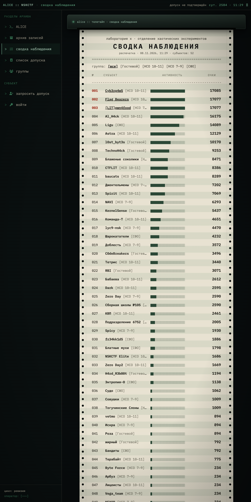
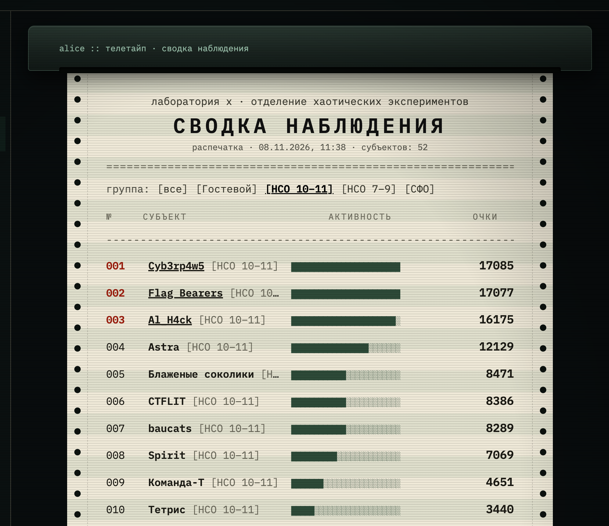
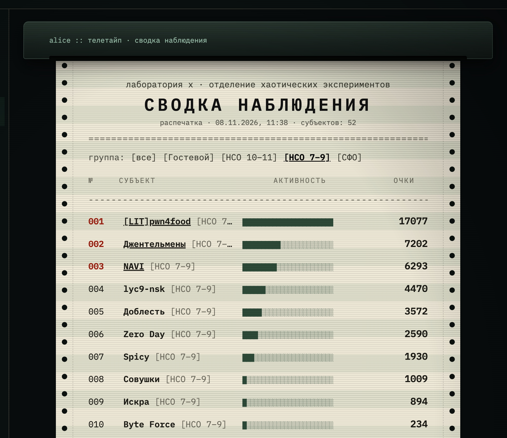
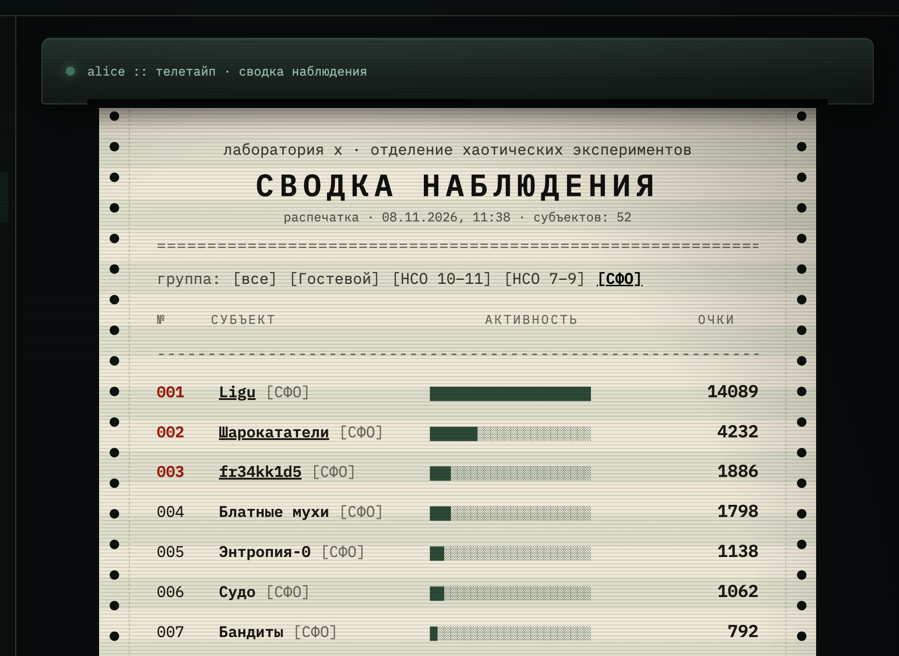
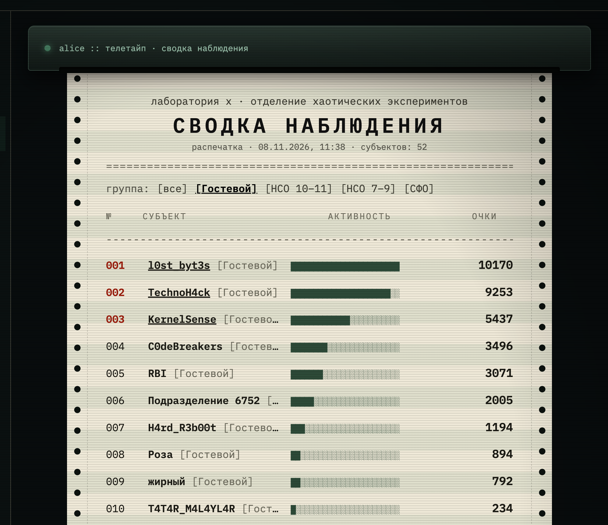

# NSK CTF II — задания и разборы

Задачи с NSK CTF (7 ноября 2026) с полными авторскими разборами и флагами.

## Итоги

Общий зачёт:



Топ-10 по зачётам:

**НСО 10–11**



**НСО 7–9**



**СФО**



**Гостевой**



## Структура

Задания разбиты по категориям. Каждое задание — отдельная папка:

```
<категория>/<задание>/
  README.md  — условие, разбор, флаг
  public/    — файлы, выдававшиеся участникам (если были)
  src/       — исходники задания
  solve/     — авторское решение и эксплойты
  deploy/    — Dockerfile и compose для самостоятельного запуска
```