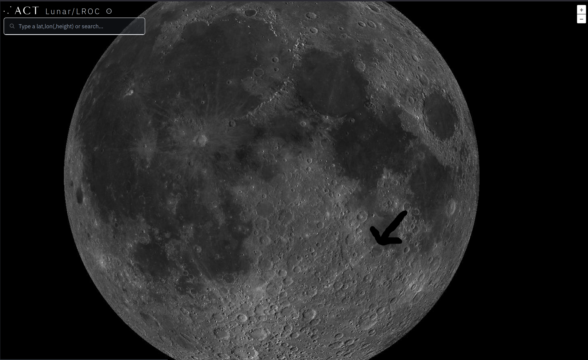

# Решение задачи «Вечерние демонстрации»

## Общая информация

- **Уровень:** Easy
- **Категория:** osint
- **Вектор:** накладная → фотодневник mr. Fade → фото Луны → опознание кратера **Fracastorius** → год смерти учёного, в чью честь назван кратер (1553) → флаг

---

## Шаг 1. От накладной к странице

В накладной — получатель **mr. Fade**, выданный рефлектор с примечанием «для вечерних демонстраций» и ник `fade-evening-demos`. По нику в GitHub находится профиль и его публичный репозиторий со страницей фотодневника.

## Шаг 2. Фотодневник

Целевой снимок — фото Луны с подписью «последний показ».

## Шаг 3. Снимок перевёрнут

Инструмент из накладной — **200-мм рефлектор**, он даёт изображение, повёрнутое на 180° (зеркала рефлектор не добавляет). Первый шаг — развернуть кадр на 180°.

## Шаг 4. Опознание кратера

Главная зацепка — длинная извилистая борозда на затопленном дне, плюс дуга вала. По этим признакам в открытом атласе (LROC QuickMap, Virtual Moon Atlas) кратер опознаётся как **Fracastorius**.



## Шаг 5. Проверяемое число → флаг

Кратер назван в честь итальянского учёного **Джироламо Фракасторо** (Girolamo Fracastoro). Год его смерти — **1553**.

```
nskctf{fracastorius_1553}
```
